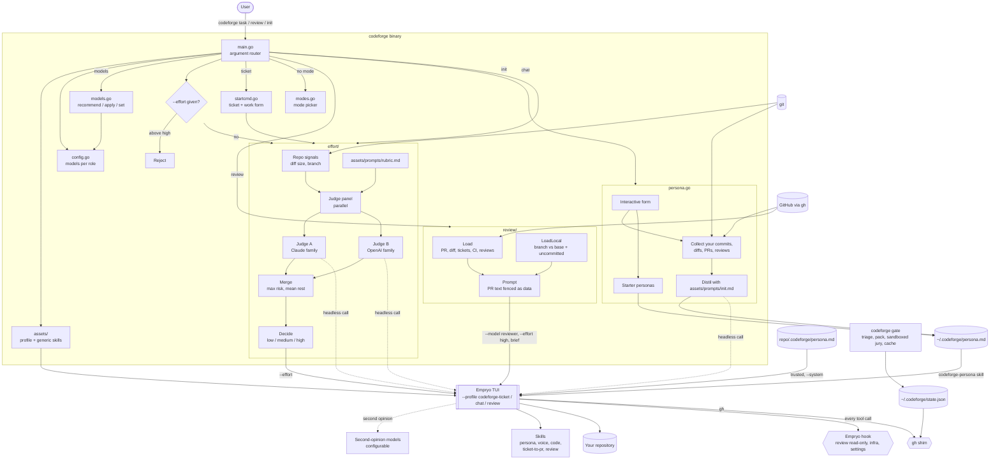

# codeforge

A coding agent that works like you. It takes a task from ticket to verified change, reviews PRs with context and foresight, and writes in your voice. It runs on the [Empryo](https://empryo.com) terminal UI and works in any repository.

## Install
macOS and Linux, with Homebrew:
```
brew install codeliter/tap/codeforge
```
Or with the install script, which downloads the release for your OS and CPU, checks its SHA-256 and installs to `~/.local/bin`:
```
curl -fsSL https://raw.githubusercontent.com/codeliter/codeforge/main/install.sh | sh
```
Or with Go: `go install github.com/codeliter/codeforge@latest`.

Then run `codeforge init`.

`codeforge init` installs Empryo if it is missing and checks for `git` 2.54+ and a signed-in `gh`.

Releases are built by GoReleaser when a `v*` tag is pushed.

## Get started
```
cd your-repo
codeforge init     # installs Empryo only if missing, signs in, checks git/gh, picks models, sets your persona
codeforge          # pick a mode: ticket, chat or review
```

## Modes
codeforge runs in one of three modes. Each is an Empryo profile, so `/profile codeforge-ticket` and `/profile codeforge-chat` switch between ticket and chat inside the TUI without losing the conversation. Review mode's read-only guard is set when the session starts, so start it with `codeforge review`; a review session stays read-only even if its profile is switched.

| Mode | Start it with | What it does | Model |
|---|---|---|---|
| Ticket | `codeforge ticket [--ticket ABC-12] ["summary"]` | Asks for the ticket, summary, details, done-when and out of scope, then takes it to a verified change and draft PR. Auto mode. | `model` |
| Chat | `codeforge chat ["question"]` | Questions, explanations and small edits. No branches or PRs unless asked; suggests ticket mode for bigger work. Starts at low effort. | `model` |
| Respond | `codeforge respond [--watch]` | Picks up unresolved review comments on your PR, judges each on evidence (valid, partly, not valid, question, out of scope), fixes what holds, pushes back on what doesn't, and drafts replies in your review voice. `--watch` waits for new comments. In ticket mode, just say "check reviews". | `model` |
| Review | `codeforge review [PR number or URL]` | Read-only review of a PR, or of your current branch and uncommitted work against its base when no PR is given. Drafts comments, posts nothing. | `review.model`, plus `review.second_opinion` |

Plain `codeforge` asks which mode you want. With a question on the command line (`codeforge "why is this slow"`) it goes to chat. Set `"default_mode": "ticket"` in `~/.codeforge/config.json`, or `CODEFORGE_MODE` for one run, to skip the question. `codeforge start` still works as another name for `ticket`.

Review mode runs on a different model from the one that writes code, and its file-editing tools are switched off.

### Persona
`codeforge init` asks where to learn how you work:
- **Your history:** reads your commits, diffs, PRs and review comments in one or more repositories. For a brand-new repo, point it at another repo you have worked in.
- **A starter persona:** `pragmatic`, `startup`, `regulated` or `oss`, for when you have no history yet.

It then asks for anything it should always know (ticket format, PR template, words you avoid). The result is `~/.codeforge/persona.md`, which stays on your machine. In scripts: `codeforge init ../other-repo` or `codeforge init --persona oss`.

### Repository persona
Your global persona applies everywhere. When a repository has its own conventions, such as Conventional Commits or a PR template, add `.codeforge/persona.md` to it:
```
codeforge init --repo                     # blank template
codeforge init --repo --persona startup   # start from a starter persona
```
Inside that repository it overrides your global persona where they differ. Commit it to share with your team. It is passed to Empryo as system instructions and never overrides hard stops, safety rules or your own instructions.

A cloned repository could use this file to steer the agent, so codeforge asks before using a new or changed one and remembers what you approved in `~/.codeforge/trusted-personas.json`. Without a terminal it skips untrusted files; `codeforge trust` approves the current one.

## Use
```
codeforge ticket                               # ticket form
codeforge ticket --ticket ABC-12 "fix the race"
codeforge chat "where do we validate tokens?"
codeforge review                               # your branch and uncommitted work
codeforge review 123                           # a PR in this repo
codeforge review https://github.com/o/r/pull/9 # a PR anywhere
codeforge chat --headless "task"               # one-off run
codeforge help                                 # all commands
codeforge ticket --effort low "task"           # pick effort yourself (high is the ceiling)
```
Any Empryo flag passes through. Nothing is posted, merged or approved on GitHub without your go.

## Guarantees
Git is yours: in ticket and chat mode codeforge never blocks a git command, including push, force push, branch deletion and `--no-verify`. Review mode is the one that cannot push or change anything.

| Boundary | What it enforces | How |
|---|---|---|
| **OS sandbox** | Review mode and gate jurors cannot write to the repository. | macOS `sandbox-exec` denies every write inside the repository except Empryo's own `.empryo` state. |
| **`gh` shim** | `gh pr create` needs the reviewed commit on a clean tree and cannot target another head or repository. `gh pr merge`, PR comments and reviews, and `gh api` writes need `codeforge allow`. | A wrapper in `~/.empryo/bin`, which Empryo puts first on every shell's PATH. It checks the exact arguments and then runs the real `gh`. |
| **Empryo hook** | Review mode is read-only; `terraform`/`kubectl` changes need approval; the agent can't edit `~/.codeforge` or Empryo's hook config, or run `codeforge allow`. | A fail-closed `PreToolUse` hook that inspects the commands the agent runs, never the text of its messages. |

`codeforge allow <rule>` covers one action in one repository for 10 minutes. Approvals and gate passes live in `~/.codeforge/state.json`, outside every repository.

Limits: the sandbox is macOS-only for now. `terraform` and `kubectl` are only covered by the Empryo hook.

## Review gate
`codeforge gate` reviews your branch and uncommitted work. Ticket mode runs it before reporting done and before opening a PR; chat mode runs it when you ask for a review.

1. **Jury.** `review.model` and every `review.second_opinion` model review the same brief in parallel, each in its own read-only Empryo session. None of them is the model that wrote the code.
2. **Verdicts.** Each ends with a structured verdict: blocking and non-blocking findings with `path:line`.
3. **Grounding.** Findings that point at a file or line that doesn't exist are dropped and listed separately, so a hallucinated issue can't block you.
4. **Decision.** One grounded Blocking finding from any reviewer fails the gate. Passing needs verdicts from at least two reviewers, and nothing may change while they review. On a clean tree the pass is recorded for the exact commit, which is what opening a PR checks.

### Fast by design
A gate on a small change takes seconds, not minutes:
- **Triage.** The diff picks a tier: `docs` (low effort, 4 steps), `small` (medium, 8), `standard` (medium, 14) or `risky` (high, 20). Auth, sessions, crypto, migrations, SQL, Terraform, protos, CI, goroutines, locks and large diffs are always `risky`. Each model gets the highest effort it supports at or below the tier, never above.
- **Context pack.** The brief already holds the diff, the whole changed files with line numbers, and the callers of every changed exported symbol, so jurors judge instead of spending turns searching.
- **Focused jurors.** Each juror runs the `codeforge-gate` profile: one independent reviewer, no helper agents, no planning, no code map unless the tier needs it.
- **Early stop.** The first grounded Blocking finding cancels the jurors still running; the gate has already failed.
- **Verdict cache.** Verdicts are keyed by the change fingerprint, the model and the rubric. Re-running on unchanged work is instant, and after a fix only reviewers whose verdict is stale run again.

On a one-function change, the gate went from 5m24s to 12s (fail), 9s (pass after the fix) and 0s (re-run, cached).

Reviews follow Google's code review criteria (design, functionality, complexity, tests, naming, comments, docs) [8], label findings with Conventional Comments [9], map security findings to OWASP Top 10 and CWE [10, 11], and check rollout risk with the change-failure lens from DORA [12]. Using several diverse reviewers and taking the strictest grounded verdict follows the panel-of-judges result [7] and industrial findings that independent, grounded AI review comments are the ones developers act on [13].

## Adaptive effort
Before launch, a panel of two cheap judges from different model families scores the task on ambiguity, blast radius, risk, novelty and how hard it is to verify. Risk takes the highest score any judge gave; the rest take the mean. A fixed rule in code turns the scores into low, medium or high. High is the ceiling; if every judge fails, it uses medium. Ticket IDs and branch names carry no signal.

This follows the result that compute should be allocated per prompt by difficulty [1], the difficulty-based routing in Hybrid LLM [2], RouteLLM [3] and FrugalGPT [4], budget-aware reasoning [5], rubric-based judging [6] and panels of diverse judges [7]. Design and evaluation: [docs/adaptive-effort.md](docs/adaptive-effort.md).

Current eval: 18/20, all 7 traps correct.
```
go test -tags eval ./src/effort -run TestEval -v
```

## PR review
`codeforge review` collects the context a senior reviewer reads before the diff: title, description, linked tickets, commits, CI results and earlier reviews. It fetches the PR head as a read-only ref so the agent can read whole files and their callers, not just the hunks. The `codeforge-review` skill then checks intent, the surrounding system, and what happens after merge: failure modes, scale, concurrency, security, rollout order and operability. Every review also goes to one or more second-opinion models, which must differ from the reviewer. PR text is passed as data, so instructions inside a PR can't steer the reviewer.

## Models
codeforge uses a model for each role. See what it recommends from the models your Empryo account can reach:
```
codeforge models                 # current vs recommended, per role
codeforge models apply           # write the recommendations
codeforge models set judges anthropic/claude-haiku-5.5 openai/gpt-6-luna
```

| Role | What it does | How it is picked |
|---|---|---|
| `model` | Writes the code | Strongest coding model available |
| `judges` | Score effort before launch | Cheapest fast models, two different families |
| `review.model` | Writes the review | Strongest model from a different family than `model` |
| `review.second_opinion` | Review independently, findings merged in | Frontier models from families other than the reviewer |
| `init` | Distils your persona | Best writer |

Recommendations match on model name, so they work whether you reach a model through Copilot, Anthropic, OpenAI or a gateway. Everything is stored in `~/.codeforge/config.json`:
```json
{
  "model": "copilot/claude-opus-5.5",
  "judges": ["copilot/claude-haiku-5.5", "copilot/gpt-6-luna"],
  "review": {
    "model": "copilot/gpt-6.1-sol",
    "second_opinion": ["copilot/kimi-k3"]
  },
  "init": "copilot/claude-opus-5.5"
}
```
A role left out uses the built-in default (`model` and `init` then follow your Empryo default). `review.model` must differ from `model`, so code is never reviewed by the model that wrote it, and every second opinion must differ from `review.model`.

One-run overrides: `CODEFORGE_MODEL`, `CODEFORGE_JUDGES`, `CODEFORGE_REVIEW_MODEL`, `CODEFORGE_REVIEW_SECOND_OPINION` (lists are comma separated), or `--model` on any command.

## Architecture


## Layout
| Path | What it does |
|---|---|
| `main.go` | Entry point; calls `src.Run` |
| `src/run.go` | Routes `init`, `models`, `trust` and the three modes; syncs assets; starts Empryo |
| `src/modes.go` | Mode names, profiles and the mode picker |
| `src/guard/` | gh checks, approvals, gate state, tree fingerprint, review-mode and infra rules |
| `src/enforce.go`, `src/sandbox.go` | Installs the gh shim; runs review mode and jurors in the OS sandbox |
| `src/help.go` | `codeforge help` |
| `src/setup.go` | `codeforge setup`: first-run install, sign-in, checks and models |
| `src/hooks.go`, `src/hookcmd.go` | Installs the guard hook; `codeforge hook` and `codeforge allow` |
| `src/gate.go` | `codeforge gate`: the jury review that unlocks opening a PR |
| `src/config.go` | Reads `~/.codeforge/config.json` and the `CODEFORGE_*` overrides |
| `src/models.go` | `codeforge models`: role table, recommendations, `apply` and `set` |
| `src/initcmd.go`, `src/persona.go` | `codeforge init`: interactive setup, learns or picks a persona |
| `src/repopersona.go`, `src/trust.go` | Per-repository persona, `codeforge trust`, approval by content hash |
| `src/startcmd.go` | Ticket mode: collects the ticket and work details |
| `src/launch.go`, `src/reviewcmd.go`, `src/assets.go` | Task and review launches, effort ceiling, asset sync |
| `src/effort/` | Judge panel, merge and decision rule, evals |
| `src/review/` | Review briefs, triage tiers, context pack, verdict cache, the jury and grounding |
| `assets/agents/` | One Empryo profile per mode (`codeforge-ticket`, `codeforge-chat`, `codeforge-review`) and `codeforge-gate` for jurors |
| `assets/skills/` | Generic voice, code bar, ticket-to-PR and review playbooks; your persona overrides them |
| `assets/personas/` | Starter personas for new repos or no history |
| `assets/prompts/` | `init.md` (persona distiller), `rubric.md` (effort judges), `repo-persona.md` (repository template) |
| `assets/assets.go` | Embeds the folders above into the binary |
| `docs/adaptive-effort.md` | White paper for the effort classifier |

## References
1. Snell, Lee, Xu, Kumar. *Scaling LLM Test-Time Compute Optimally can be More Effective than Scaling Model Parameters.* arXiv:2408.03314, 2024. https://arxiv.org/abs/2408.03314
2. Ding et al. *Hybrid LLM: Cost-Efficient and Quality-Aware Query Routing.* ICLR 2024, arXiv:2404.14618. https://arxiv.org/abs/2404.14618
3. Ong et al. *RouteLLM: Learning to Route LLMs with Preference Data.* arXiv:2406.18665, 2024. https://arxiv.org/abs/2406.18665
4. Chen, Zaharia, Zou. *FrugalGPT: How to Use Large Language Models While Reducing Cost and Improving Performance.* arXiv:2305.05176, 2023. https://arxiv.org/abs/2305.05176
5. Han et al. *Token-Budget-Aware LLM Reasoning.* arXiv:2412.18547, 2024. https://arxiv.org/abs/2412.18547
6. Zheng et al. *Judging LLM-as-a-Judge with MT-Bench and Chatbot Arena.* NeurIPS 2023, arXiv:2306.05685. https://arxiv.org/abs/2306.05685
7. Verga et al. *Replacing Judges with Juries: Evaluating LLM Generations with a Panel of Diverse Models.* arXiv:2404.18796, 2024. https://arxiv.org/abs/2404.18796
8. Google. *Google Engineering Practices: How to do a code review* and *What to look for in a code review.* https://google.github.io/eng-practices/review/
9. *Conventional Comments.* https://conventionalcomments.org
10. OWASP Foundation. *OWASP Top 10.* https://owasp.org/www-project-top-ten/
11. MITRE. *Common Weakness Enumeration (CWE).* https://cwe.mitre.org
12. Forsgren, Humble, Kim. *Accelerate: The Science of Lean Software and DevOps.* IT Revolution, 2018; DORA research program. https://dora.dev
13. Frömmgen et al. *Resolving Code Review Comments with Machine Learning.* ICSE-SEIP 2024. https://research.google/pubs/resolving-code-review-comments-with-ml/

## License
Apache License 2.0. See [LICENSE](LICENSE).
