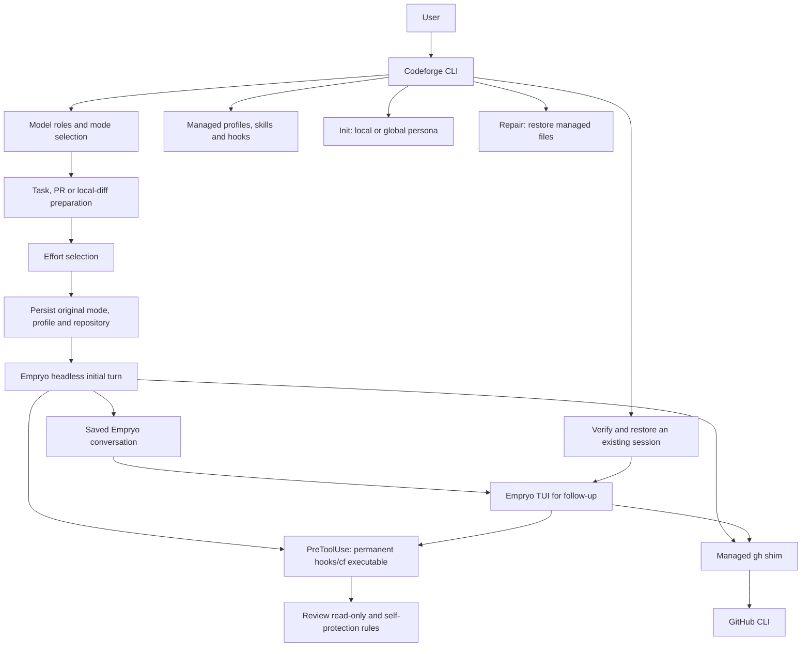
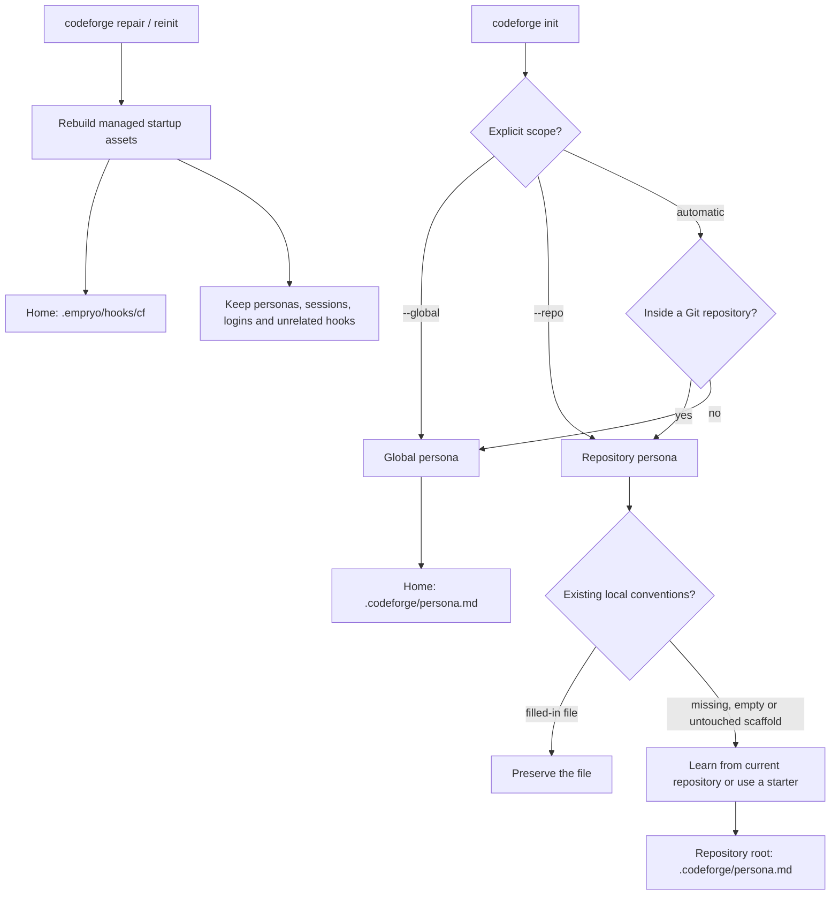
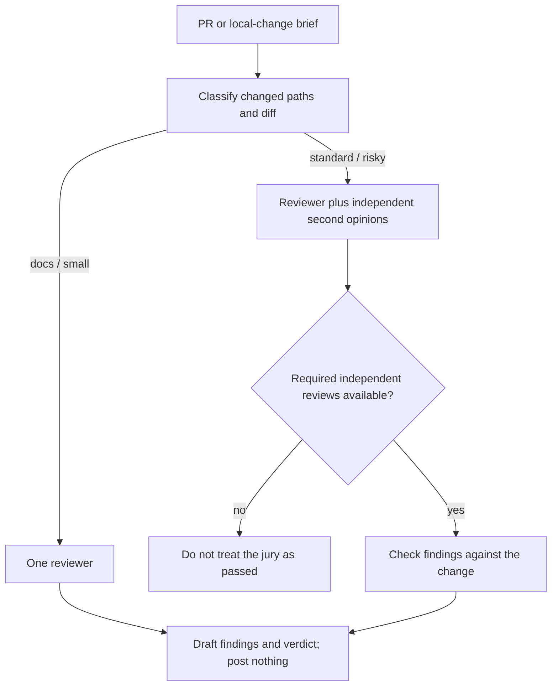

# Codeforge: architecture and design references

For installation and everyday commands, use the [README](README.md).
This guide explains the implementation, trust boundaries, and research behind the design.
It describes the code in this repository; provider capabilities and Empryo behaviour can change independently.

## 1. System overview

Codeforge is a Go CLI around Empryo, not a second model/tool execution engine.
It prepares tasks, installs its managed assets, chooses models and effort, records session identity,
and applies its review-mode protections. Empryo owns model requests, tools, context management,
provider fallback, the transcript, and the terminal chat screen.



The local acknowledgement is deliberately independent of the model. It confirms that Codeforge
received the job and is collecting context; it does not claim that a provider has answered.
A separate status identifies the transition to waiting for the model.

### Launch and resume

```mermaid
sequenceDiagram
    actor User
    participant CLI as Codeforge
    participant Store as Session identity store
    participant Engine as Empryo
    User->>CLI: Mode and task
    CLI-->>User: Immediate local acknowledgement
    CLI->>CLI: Collect context and choose effort
    CLI->>Store: Persist session ID, mode, profile and repository
    CLI->>Engine: Headless task with --save-session
    Note over CLI,Engine: Review launches retain the guard and read-only sandbox
    Engine-->>User: Model output, provider retries and diagnostics
    alt Initial turn succeeds and session is saved
        Engine-->>CLI: Success
        CLI->>CLI: Verify saved session metadata and log
        CLI->>Engine: Open TUI with --session and original profile
    else Initial turn fails or is interrupted
        Engine-->>CLI: Error or interruption
        CLI-->>User: Preserve exit status; do not open an empty TUI
    end
```

This two-phase launch accommodates the observed Empryo 3.12.3-beta TUI startup behaviour:
positional prompts are submitted by the headless path rather than by opening an idle TUI.
An explicit `--headless` launch remains headless. A resume skips task preparation and does not
resubmit the original task. Ctrl+C reaches the child through the foreground process group;
SIGTERM sent to the supervising CLI is forwarded to its child.

Implementation: [run.go](src/run.go), [shutdown.go](src/shutdown.go),
[sessions.go](src/sessions.go), [acknowledge.go](src/acknowledge.go).

## 2. Initialisation, personas, and repair



- Automatic init inside Git writes at the repository root, even when invoked from a subdirectory.
  It does not replace the global persona. Explicit repository input paths retain the historical
  global-learning form; `--global` makes that intention clear.
- Existing, filled-in repository personas are not overwritten. Empty files and an unchanged
  repository scaffold can be populated. Failed generation does not replace a persona with an empty result.
- Local rules take precedence over generic/global style where they differ, but never override safety rules.
  A repository persona is trusted by content hash, not merely by its path. User-initiated init trusts
  the newly created file; changed or unfamiliar files need approval before being injected as system context.
- Persona history is input data, not instructions. The distillation prompt asks for evidence-based rules
  and excludes secrets and identifying examples. Inspect a learned persona before committing it.
- `repair` (`reinit` is an alias) reinstalls managed assets without model calls or sign-in.
  It is not a factory reset and does not repair malformed user configuration, expired credentials,
  provider quotas, or network outages. Restart affected sessions after repair so cached hooks are reloaded.

Implementation: [initcmd.go](src/initcmd.go), [persona.go](src/persona.go),
[repopersona.go](src/repopersona.go), [trust.go](src/trust.go).

## 3. Enforcement boundaries

The permanent `~/.empryo/hooks/cf` helper is a private executable copy of the running Codeforge
binary. It is refreshed atomically; its lifetime is independent of temporary build paths and Homebrew
Cellar cleanup. Hook registration and the managed `gh` shim use this helper.
The installer replaces recognised legacy Codeforge entries, including `/tmp/cf`, while retaining
unrelated hooks and other hooks sharing the same rule.

The `PreToolUse` guard remains **fail-closed**. If it cannot run, a protected tool call is not allowed
through. The `SessionEnd` resume-hint hook is fail-open because shutdown must not wait on a hint.
Agent tools may not alter the guard, its helper, its configuration, or run user-only setup/repair commands.
Repair does not disable these protections.

Review mode adds two distinct layers:

1. The tool guard blocks write operations and writable commands.
2. On macOS, `sandbox-exec` refuses filesystem writes within the repository, except its `.empryo`
   runtime state. Both the initial headless turn and resumed TUI keep this sandbox.

This is **not** a network-isolation sandbox. Provider calls and other permitted network reads remain
possible. Review currently refuses to start without the supported macOS sandbox rather than silently
running with weaker filesystem protection. Outside review, Git is not an approval-gated workflow.

Implementation: [hookbinary.go](src/hookbinary.go), [hooks.go](src/hooks.go),
[hookcmd.go](src/hookcmd.go), [guard/](src/guard/), [enforce.go](src/enforce.go),
[sandbox.go](src/sandbox.go).

## 4. Effort routing and model roles

The effort classifier borrows the idea of allocating inference compute by task difficulty [1–5]
and uses rubric-based judging [6] with a diverse judge panel [7]. It is not an implementation of the
papers' trained routers, nor evidence that their reported cost or accuracy gains transfer to Codeforge.

For applicable prompted launches without an explicit effort, judges independently score ambiguity,
blast radius, risk, novelty, and verification difficulty from 0 to 2. Risk uses the maximum score;
the other dimensions use the rounded mean. A deterministic rule chooses the effort:

- **High:** risk is 2, ambiguity is 2, total is at least 7, or verification is 2 with total at least 5.
- **Low:** total is at most 2, provided no high-effort rule applies.
- **Medium:** otherwise; also the fallback when all judges fail.

Ticket and prompted chat launches can use this classifier. Work starts at medium without startup
judge calls; an idle chat starts at low. Interactive review defaults to high. An explicit supported
`--effort` wins, but Codeforge rejects levels above high.

The model-role settings are `model`, `judges`, `review.model`, `review.second_opinion`, and `init`.
Recommendations try to separate model families. Configuration validation rejects identical model IDs
for author/reviewer and reviewer/second opinion; that is not proof of independence when two IDs reach
the same underlying model through different providers.

Provider routing and fallback are separate from Codeforge's role selection. Empryo handles failures,
backoff, and backup-model attempts. Changing provider does not bypass shared connectivity failures,
and an acknowledgement is not proof that the provider request succeeded.

Implementation: [launch.go](src/launch.go), [effort/effort.go](src/effort/effort.go),
[models.go](src/models.go), [config.go](src/config.go).
The project design paper and historical evaluation are in [adaptive-effort.md](docs/adaptive-effort.md).
Its small evaluation set is not a release-by-release benchmark or a guarantee of calibration.

## 5. Reviews and independent checks

Review briefs collect intent, commits, checks, prior reviews, tickets, and the diff before asking
for findings. Author-controlled PR text is marked as data. The review playbook draws on engineering
review practices [8], labelled feedback [9], security taxonomies [10–11], delivery/operability research
[12], and work on resolving review comments [13]. These are design references, not certifications.



Triage is based on actual files and diff content, not the PR title. A PR labelled “docs” can still be
`standard`, for example when it also changes a root YAML configuration file. `docs` and `small` skip
the jury; `standard` and `risky` request it.

The interactive review's jury requirement is expressed in the brief and skill. The separate voluntary
`codeforge gate` also has programmatic quorum, verdict parsing, cache, and finding-grounding checks.
Do not confuse a rendered draft with a machine-validated gate pass. A quota failure or repository rule
forbidding a configured juror does not count as an independent review and must not silently become approval.

Implementation: [reviewcmd.go](src/reviewcmd.go), [review/triage.go](src/review/triage.go),
[review/jury.go](src/review/jury.go), [gate.go](src/gate.go),
[review skill](assets/skills/codeforge-review/SKILL.md).

## 6. State and recovery

| Location | Purpose |
| --- | --- |
| Repository `.codeforge/persona.md` | Project-specific conventions |
| `~/.codeforge/persona.md` | Global conventions |
| `~/.codeforge/config.json` | Codeforge model roles and default mode |
| `~/.codeforge/trusted-personas.json` | Persona approvals tied to content hashes |
| `~/.codeforge/sessions/sessions.db` | Original session mode/profile/repository and inert learning evidence |
| Repository `.empryo/sessions/ID` | Empryo metadata, transcript, and session state |
| `~/.empryo/hooks/cf` | Permanent managed hook executable |
| `~/.empryo/hooks.json` | Hook registration; other user hooks are retained |
| `~/.empryo/agents` and `~/.empryo/skills` | Generated Codeforge profiles and skills |
| `~/.empryo/bin/gh` | Managed GitHub CLI shim |

Session identity is recorded before the engine starts. Resume checks the saved workspace, metadata,
and transcript; missing or mismatched state fails instead of creating a fresh conversation.
The SQLite store uses embedded transactional migrations, WAL, full synchronous durability, bounded
lock/operation waits, and private filesystem permissions. Its learning observations do not change
prompts, approvals, or guard policy. Review verdict caching is separate from this store.

See [store/](src/store/), [sessions.go](src/sessions.go), [learncmd.go](src/learncmd.go),
and [review/cache.go](src/review/cache.go). Do not delete the database as a routine repair step.

## 7. Citations

These references are retained from the earlier technical README and the adaptive-effort design paper.
Research papers [1–7, 13] are distinguished from engineering guides, standards, and a book/research programme [8–12].
They explain influences on the design, not claims that Codeforge reproduces each paper's method or results.

1. Snell, Lee, Xu, Kumar. *Scaling LLM Test-Time Compute Optimally can be More Effective than Scaling Model Parameters.* arXiv:2408.03314, 2024. <https://arxiv.org/abs/2408.03314>
2. Ding et al. *Hybrid LLM: Cost-Efficient and Quality-Aware Query Routing.* ICLR 2024, arXiv:2404.14618. <https://arxiv.org/abs/2404.14618>
3. Ong et al. *RouteLLM: Learning to Route LLMs with Preference Data.* arXiv:2406.18665, 2024. <https://arxiv.org/abs/2406.18665>
4. Chen, Zaharia, Zou. *FrugalGPT: How to Use Large Language Models While Reducing Cost and Improving Performance.* arXiv:2305.05176, 2023. <https://arxiv.org/abs/2305.05176>
5. Han et al. *Token-Budget-Aware LLM Reasoning.* arXiv:2412.18547, 2024. <https://arxiv.org/abs/2412.18547>
6. Zheng et al. *Judging LLM-as-a-Judge with MT-Bench and Chatbot Arena.* NeurIPS 2023, arXiv:2306.05685. <https://arxiv.org/abs/2306.05685>
7. Verga et al. *Replacing Judges with Juries: Evaluating LLM Generations with a Panel of Diverse Models.* arXiv:2404.18796, 2024. <https://arxiv.org/abs/2404.18796>
8. Google. *Engineering Practices: How to do a code review* and *What to look for in a code review.* <https://google.github.io/eng-practices/review/>
9. *Conventional Comments.* <https://conventionalcomments.org>
10. OWASP Foundation. *OWASP Top 10.* <https://owasp.org/www-project-top-ten/>
11. MITRE. *Common Weakness Enumeration (CWE).* <https://cwe.mitre.org>
12. Forsgren, Humble, Kim. *Accelerate: The Science of Lean Software and DevOps.* IT Revolution, 2018; DORA research programme. <https://dora.dev>
13. Austin et al. *Resolving Code Review Comments with Machine Learning.* ICSE-SEIP 2024. <https://research.google/pubs/resolving-code-review-comments-with-machine-learning/>
