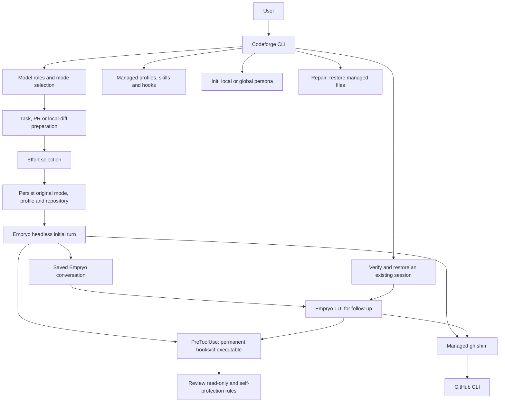
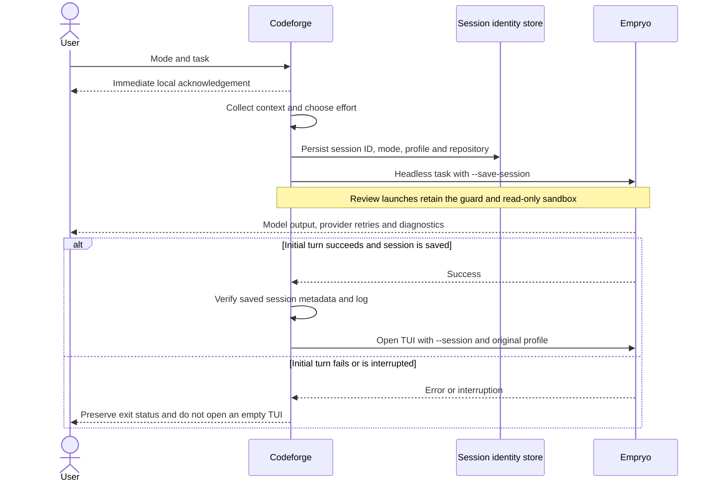
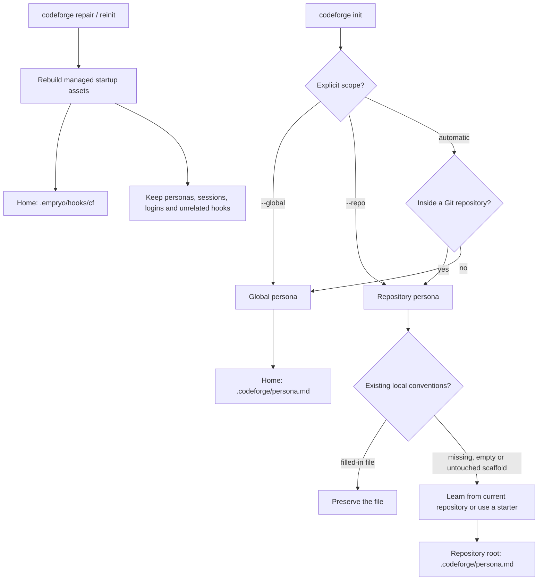
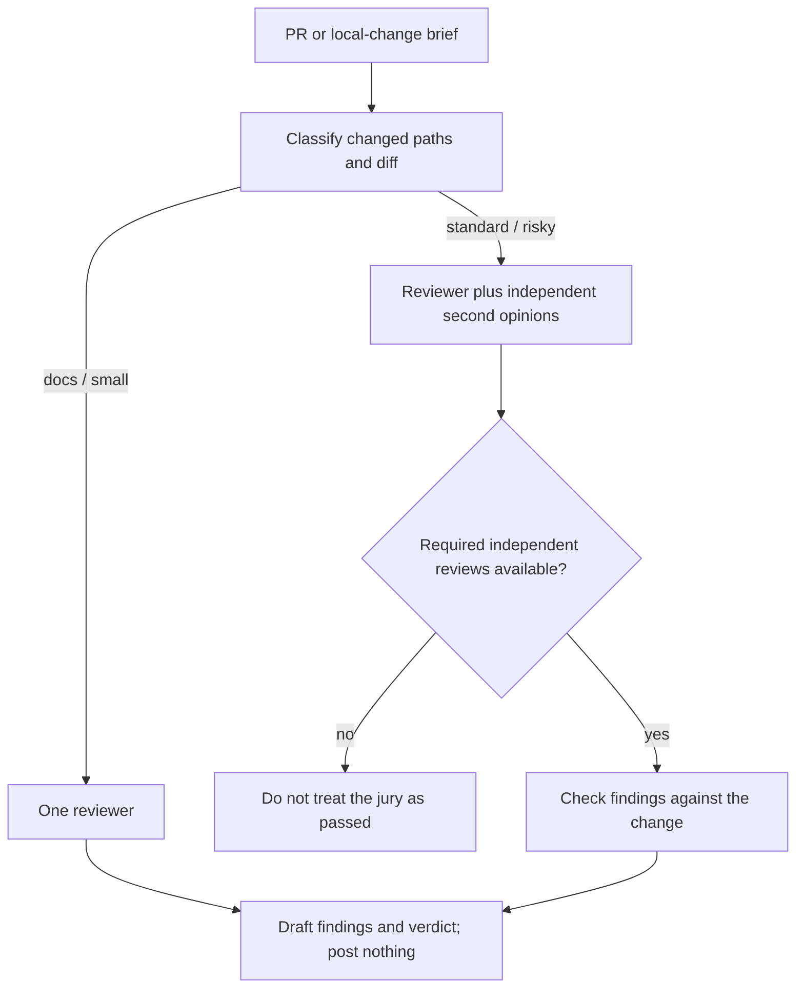

# Codeforge: architecture and design references

For installation and everyday commands, use the [README](README.md).
This guide explains the implementation, trust boundaries, and research behind the design.
It describes the code in this repository; provider capabilities and Empryo behaviour can change independently.

## 1. System overview

Codeforge is a Go CLI around Empryo, not a second model/tool execution engine.
It prepares tasks, installs its managed assets, chooses models and effort, records session identity,
and applies its review-mode protections. Empryo owns model requests, tools, context management,
provider fallback, the transcript, and the terminal chat screen.

The local acknowledgement is deliberately independent of the model. It confirms that Codeforge
received the job and is collecting context; it does not claim that a provider has answered.
A separate status identifies the transition to waiting for the model.

### Launch and resume

This two-phase launch accommodates the observed Empryo 3.12.3-beta TUI startup behaviour:
positional prompts are submitted by the headless path rather than by opening an idle TUI.
An explicit `--headless` launch remains headless. A resume skips task preparation and does not
resubmit the original task. Ctrl+C reaches the child through the foreground process group;
SIGTERM sent to the supervising CLI is forwarded to its child.

Implementation: [run.go](src/run.go), [shutdown.go](src/shutdown.go),
[sessions.go](src/sessions.go), [acknowledge.go](src/acknowledge.go).

## 2. Initialisation, personas, and repair

- Automatic init inside Git writes at the repository root, even when invoked from a subdirectory.
  It does not replace the global persona. Explicit repository input paths retain the historical
  global-learning form; `--global` makes that intention clear.
- `init --persona` opens a selector with the available starter names and short descriptions.
  An explicit name, such as `--persona oss`, skips the selector. Non-interactive callers must
  supply a name; otherwise the command lists the choices and stops without writing a persona.
- Existing, filled-in repository personas are not overwritten. Empty files and an unchanged
  repository scaffold can be populated. Failed generation does not replace a persona with an empty result.
- Local rules take precedence over generic/global style where they differ, but never override safety rules.
  A repository persona is trusted by content hash, not merely by its path. User-initiated init trusts
  the newly created file; changed or unfamiliar files need approval before being injected as system context.
- Persona history is input data, not instructions. The distillation prompt asks for evidence-based rules
  and excludes secrets and identifying examples. Inspect a learned persona before committing it.
- `repair` (`reinit` is an alias) reinstalls managed assets without model calls or sign-in.
  It is not a factory reset and does not repair malformed user configuration, expired credentials,
  provider quotas, or network outages. Restart affected sessions after repair so cached hooks are reloaded.

Implementation: [initcmd.go](src/initcmd.go), [persona.go](src/persona.go),
[repopersona.go](src/repopersona.go), [trust.go](src/trust.go).

## 3. Enforcement boundaries

The permanent `~/.empryo/hooks/cf` helper is a private executable copy of the running Codeforge
binary. It is refreshed atomically; its lifetime is independent of temporary build paths and Homebrew
Cellar cleanup. Hook registration and the managed `gh` shim use this helper.
The installer replaces recognised legacy Codeforge entries, including `/tmp/cf`, while retaining
unrelated hooks and other hooks sharing the same rule. Unknown renamed binaries are not assumed to be
Codeforge: the user can explicitly identify one with `repair --legacy-hook /absolute/old/path`.
That migrates only exact executable/Codeforge-subcommand matches in the global hook registry;
a missing match produces a warning to inspect project or other agent settings. It does not disable
fail-closed behaviour or indiscriminately delete missing security hooks.

The `PreToolUse` guard remains **fail-closed**. If it cannot run, a protected tool call is not allowed
through. The `SessionEnd` resume-hint hook is fail-open because shutdown must not wait on a hint.
Agent tools may not alter the guard, its helper, its configuration, or run user-only setup/repair commands.
Repair does not disable these protections.

Review mode adds two distinct layers:

1. The tool guard blocks write operations and writable commands.
2. On macOS, `sandbox-exec` refuses filesystem writes within the repository, except its `.empryo`
   runtime state. Both the initial headless turn and resumed TUI keep this sandbox.

This is **not** a network-isolation sandbox. Provider calls and other permitted network reads remain
possible. Review currently refuses to start without the supported macOS sandbox rather than silently
running with weaker filesystem protection. Outside review, Git is not an approval-gated workflow.

Implementation: [hookbinary.go](src/hookbinary.go), [hooks.go](src/hooks.go),
[hookcmd.go](src/hookcmd.go), [guard/](src/guard/), [enforce.go](src/enforce.go),
[sandbox.go](src/sandbox.go).

## 4. Effort routing and model roles

The effort classifier borrows the idea of allocating inference compute by task difficulty [1–5]
and uses rubric-based judging [6] with a diverse judge panel [7]. It is not an implementation of the
papers' trained routers, nor evidence that their reported cost or accuracy gains transfer to Codeforge.

For applicable prompted launches without an explicit effort, judges independently score ambiguity,
blast radius, risk, novelty, and verification difficulty from 0 to 2. Risk uses the maximum score;
the other dimensions use the rounded mean. A deterministic rule chooses the effort:

- **High:** risk is 2, ambiguity is 2, total is at least 7, or verification is 2 with total at least 5.
- **Low:** total is at most 2, provided no high-effort rule applies.
- **Medium:** otherwise; also the fallback when all judges fail.

Ticket and prompted chat launches can use this classifier. Work starts at medium without startup
judge calls; an idle chat starts at low. Interactive review defaults to high. An explicit supported
`--effort` wins, but Codeforge rejects levels above high.

The model-role settings are `model`, `expert`, `judges`, `review.model`, `review.second_opinion`, and `init`.
The new-install coding default is Sonnet 5.5; the `codeforge-expert` delegate uses Opus 5.5 only for a bounded difficult task.
Saved model choices are not overwritten. Gemini 4 Argon is excluded from Codeforge recommendations and selection lists;
existing manually configured native Empryo routing/fallback settings are not silently rewritten.
Recommendations try to separate model families. Configuration validation rejects identical model IDs
for author/reviewer and reviewer/second opinion; that is not proof of independence when two IDs reach
the same underlying model through different providers.

Provider routing and fallback are separate from Codeforge's role selection. Empryo handles failures,
backoff, and backup-model attempts. Changing provider does not bypass shared connectivity failures,
and an acknowledgement is not proof that the provider request succeeded.

Implementation: [launch.go](src/launch.go), [effort/effort.go](src/effort/effort.go),
[models.go](src/models.go), [config.go](src/config.go).
The project design paper and historical evaluation are in [adaptive-effort.md](docs/adaptive-effort.md).
Its small evaluation set is not a release-by-release benchmark or a guarantee of calibration.

### YAML configuration and launch-only overrides

`codeforge models configure` lists the authenticated provider catalog and opens role selectors.
The wizard asks for project or global scope; `--project` and `--global` select it explicitly.
It saves only after confirmation and validation, using a private, atomically replaced YAML file.
Cancellation leaves existing settings unchanged. Existing, temporarily unavailable model IDs are labelled as saved rather than falsely listed as available.

- Global settings: `~/.codeforge/config.yaml`. Legacy `~/.codeforge/config.json` is read only when YAML is absent.
  The files are alternatives, not merged layers. Saving keeps the old JSON file unchanged and writes the complete selected YAML configuration.
- Project overrides: `.codeforge/config.yaml` at the Git repository root, including when launched from a subdirectory.
  They are content-hash trust gated before parsing/application, just like repository personas. An unapproved or changed checkout cannot
  nominate its own reviewers or routing; non-interactive launches skip it with a notice. Inspect manual/shared changes and run
  `codeforge trust --models` to approve them. The wizard records the exact bytes it writes, not a second read vulnerable to substitution.
  Repair and trust operate before project configuration is loaded, so a broken checkout file cannot prevent recovery.
  The trust dialog shows the complete parsed effective model settings, not a raw prefix that comments could pad to hide reviewers.
  Declining an existing file's trust does not authorize overwriting it: the project wizard separately asks before replacing an unapproved file.
  This approval covers Codeforge's model file only, not arbitrary Empryo project configuration or programs it may start.
- Precedence for Codeforge roles: explicit `--model` for the active role, then `CODEFORGE_*` environment values,
  then project YAML, global YAML/legacy JSON, and built-in defaults. `CODEFORGE_INIT` controls persona generation;
  `CODEFORGE_EXPERT` controls the on-demand expert. When `init` is omitted, persona generation follows the configured coding model rather than silently selecting another provider.
- `models set` and setup's `fill` retain their global Codeforge YAML write scope. `models recommend` is read-only.
  `models apply [--project|--global]` applies saved fallback choices to native Empryo. With `--recommended`, it first previews
  recommended role changes, saves them only after confirmation at the chosen scope (project changes are content-approved), keeps helper routing and other settings, then applies fallback. It requires a terminal,
  offers an inferred scope (project inside Git or with a local model file, global otherwise), previews exact native changes and asks for confirmation.
  Explicit scope flags skip the scope selector, not confirmation. Global application reads only saved global choices; project application uses approved project overrides.
  One-off environment model overrides are excluded from persistent application.
  `models` displays effective project-aware roles. YAML rejects unknown keys, duplicate mappings, invalid types, and multiple documents.

The schema also accepts `providers: {primary: devpass, fallback: copilot}` and model names such as `Sonnet 5.5`.
`devpass` resolves to the native `llmgateway` provider ID; this is an account alias, not a billing override.
The wizard offers a provider-defaults style and an advanced explicit-ID style. Names resolve against authenticated-provider catalog IDs,
normalising spaces, version punctuation, and Claude family aliases. Unknown or ambiguous names fail before a model-backed task.
Explicit `provider/model` IDs retain their previous semantics, including unavailable saved IDs and native fallback.
Switching styles is an explicit migration of model references at the selected scope; cancelling does not save it.
Provider policies replace the corresponding global policy as a block; a project `providers: {}` clears inherited provider defaults.

A chosen backup requires the same named model on that provider. Only an explicit, confirmed `models apply` installs fallback maps;
configuration, plan inspection and normal launches remain non-writing. No unproven preset overlay is used.
Before model work it reads global, project, and effective `modelFallback` settings through the documented ACP config extension,
without a prompt or config write, then deletes only its own query session. Declared and effective chains must both match, including
no undeclared extra backup hop. Missing or incompatible chains fail closed and direct the user to `models apply` or Empryo `/router`.
The apply command uses `_empryo/config/set` for the single `modelFallback` key after re-reading native layers and checking that they still match the approved preview.
It preserves unrelated rows and other settings, explicitly previews clearing undeclared extra backup hops, and verifies persisted results in a fresh read-only process.
Native project `modelFallback` replaces the whole global map; creating a project override therefore retains currently effective unrelated rows. These copied rows become project pins.
Native global writes clear the current session workspace's project override, so global application runs in a neutral temporary workspace, never the active repository.
Cancellation does not write settings. A stale preview aborts rather than overwriting intervening fallback edits; unsupported native APIs fail without a JSON-file fallback.
`codeforge models plan` prints resolved IDs and performs the same read-only verification; it does not make a model request.
Quota retry timing and actual failover remain native Empryo behaviour. No backup preference means native fallback is inherited without this check.
Roles, explicit helper routing, environment model references and CLI model arguments are resolved before generation; flag values are not reinterpreted as options.

See the complete [example configuration](config.example.yaml). The `routing` map accepts the supported Empryo profile jobs:
`research`, `editing`, `explore`, `web-search`, `cleanup`, `verify`, `review`, `goal-review`, `summaries`, and `marionette`.
Project routing entries replace the corresponding global Codeforge routing entries; an empty string resets a job to native Empryo routing.
The wizard distinguishes inheriting global routing (no entry) from explicitly resetting to native Empryo (an empty string).
Project saves record changed model roles rather than copying all global values, so future global changes still propagate.
Existing explicit project pins and routing reset entries are preserved when other roles are edited.

Codeforge passes primary-role models through native `--model` flags and installs workspace-local Codeforge agent profiles with native `routing` metadata.
Project profiles prevent two projects from overwriting one another's model/routing choices in global profiles.
The normal Empryo config file, credentials, default profile, and unrelated profiles are not rewritten.

Profile routing does **not** control every background request. Tab naming, Genome summaries, advisor, council, and other non-profile jobs
remain under Empryo's task router. Unsupported routing keys are rejected, not silently advertised as overrides.
Provider authentication, quotas, fallback chains, retries, and native background routing remain Empryo responsibilities.
See [Empryo profile routing](https://empryo.com/docs/tools/profiles#routing-jobs).

Implementation: [config_yaml.go](src/config_yaml.go), [models_configure.go](src/models_configure.go),
[profile_routing.go](src/profile_routing.go), and [config.example.yaml](config.example.yaml).

## 5. Reviews and independent checks

Review briefs collect intent, commits, checks, prior reviews, tickets, and the diff before asking
for findings. Author-controlled PR text is marked as data. The review playbook draws on engineering
review practices [8], labelled feedback [9], security taxonomies [10–11], delivery/operability research
[12], and work on resolving review comments [13]. These are design references, not certifications.

Triage is based on actual files and diff content, not the PR title. A PR labelled “docs” can still be
`standard`, for example when it also changes a root YAML configuration file. `docs` and `small` skip
the jury; `standard` and `risky` request it.

The interactive review's jury requirement is expressed in the brief and skill. The separate voluntary
`codeforge gate` also has programmatic quorum, verdict parsing, cache, and finding-grounding checks.
Do not confuse a rendered draft with a machine-validated gate pass. A quota failure or repository rule
forbidding a configured juror does not count as an independent review and must not silently become approval.

Implementation: [reviewcmd.go](src/reviewcmd.go), [review/triage.go](src/review/triage.go),
[review/jury.go](src/review/jury.go), [gate.go](src/gate.go),
[review skill](assets/skills/codeforge-review/SKILL.md).

### Reviewer-to-work handoffs inside one TUI

Work/chat can run the existing sandboxed `codeforge gate` or `codeforge review <PR> --headless` command without opening a second terminal.
The named `codeforge-reviewer` helper has a read-only native tool allowlist: read, grep, find, navigate, and final response.
It can ground findings and return `FIX_REQUEST` or `COMMENT_DRAFT` proposals, but cannot execute commands, edit, dispatch writers, or publish.

The writable parent can delegate user-authorized fixes to `codeforge-work`. A child report is not permission to change files or somebody else's branch.
For public feedback, the parent must show the exact PR target and final comment text and obtain explicit human approval before posting that draft.
Posting a comment is not approval of the PR, nor permission to push or merge. This approval workflow is expressed in the managed parent instructions;
it is not a new server-side GitHub authorization mechanism.

The native helper allowlist and the standalone review's OS sandbox are distinct protections.
A standalone read-only review cannot gain writes through a profile switch or by starting a writer inside its sandbox.
Fixes and approved publication must be handled by an already writable parent, or a separately launched writable conversation.

Implementation: [reviewer definition](assets/agents/codeforge-reviewer.md),
[work profile](assets/agents/codeforge-work.md), [chat profile](assets/agents/codeforge-chat.md).

## 6. State and recovery

| Location | Purpose |
| --- | --- |
| Repository `.codeforge/persona.md` | Project-specific conventions |
| `~/.codeforge/persona.md` | Global conventions |
| Repository `.codeforge/config.yaml` | Project model roles and profile routing overrides |
| `~/.codeforge/config.yaml` | Global Codeforge roles, routing and default mode |
| `~/.codeforge/config.json` | Legacy global configuration, read only when YAML is absent |
| `~/.codeforge/trusted-personas.json` | Persona and model-config content approvals; legacy filename retained |
| `~/.codeforge/sessions/sessions.db` | Original session mode/profile/repository and inert learning evidence |
| Repository `.empryo/sessions/ID` | Empryo metadata, transcript, and session state |
| `~/.empryo/hooks/cf` | Permanent managed hook executable |
| `~/.empryo/hooks.json` | Hook registration; other user hooks are retained |
| `~/.empryo/agents` and `~/.empryo/skills` | Generated Codeforge profiles and skills |
| `~/.empryo/bin/gh` | Managed GitHub CLI shim |

Session identity is recorded before the engine starts. Resume checks the saved workspace, metadata,
and transcript; missing or mismatched state fails instead of creating a fresh conversation.
The SQLite store uses embedded transactional migrations, WAL, full synchronous durability, bounded
lock/operation waits, and private filesystem permissions. Its learning observations do not change
prompts, approvals, or guard policy. Review verdict caching is separate from this store.

See [store/](src/store/), [sessions.go](src/sessions.go), [learncmd.go](src/learncmd.go),
and [review/cache.go](src/review/cache.go). Do not delete the database as a routine repair step.

Known concurrency limits: the JSON approval ledger is atomically replaced but concurrent approvals can still require reapproval after a last-writer update.
Owned profiles are workspace snapshots, not separate registries per terminal: simultaneous launches in the same workspace with different environment overrides
can replace each other's helper definitions. Different projects are isolated, and native Empryo configuration and Codeforge YAML settings are not rewritten by those launches.

## 7. Citations

These references are retained from the earlier technical README and the adaptive-effort design paper.
Research papers [1–7, 13] are distinguished from engineering guides, standards, and a book/research programme [8–12].
They explain influences on the design, not claims that Codeforge reproduces each paper's method or results.

1. Snell, Lee, Xu, Kumar. *Scaling LLM Test-Time Compute Optimally can be More Effective than Scaling Model Parameters.* arXiv:2408.03314, 2024. <https://arxiv.org/abs/2408.03314>
2. Ding et al. *Hybrid LLM: Cost-Efficient and Quality-Aware Query Routing.* ICLR 2024, arXiv:2404.14618. <https://arxiv.org/abs/2404.14618>
3. Ong et al. *RouteLLM: Learning to Route LLMs with Preference Data.* arXiv:2406.18665, 2024. <https://arxiv.org/abs/2406.18665>
4. Chen, Zaharia, Zou. *FrugalGPT: How to Use Large Language Models While Reducing Cost and Improving Performance.* arXiv:2305.05176, 2023. <https://arxiv.org/abs/2305.05176>
5. Han et al. *Token-Budget-Aware LLM Reasoning.* arXiv:2412.18547, 2024. <https://arxiv.org/abs/2412.18547>
6. Zheng et al. *Judging LLM-as-a-Judge with MT-Bench and Chatbot Arena.* NeurIPS 2023, arXiv:2306.05685. <https://arxiv.org/abs/2306.05685>
7. Verga et al. *Replacing Judges with Juries: Evaluating LLM Generations with a Panel of Diverse Models.* arXiv:2404.18796, 2024. <https://arxiv.org/abs/2404.18796>
8. Google. *Engineering Practices: How to do a code review* and *What to look for in a code review.* <https://google.github.io/eng-practices/review/>
9. *Conventional Comments.* <https://conventionalcomments.org>
10. OWASP Foundation. *OWASP Top 10.* <https://owasp.org/www-project-top-ten/>
11. MITRE. *Common Weakness Enumeration (CWE).* <https://cwe.mitre.org>
12. Forsgren, Humble, Kim. *Accelerate: The Science of Lean Software and DevOps.* IT Revolution, 2018; DORA research programme. <https://dora.dev>
13. Austin et al. *Resolving Code Review Comments with Machine Learning.* ICSE-SEIP 2024. <https://research.google/pubs/resolving-code-review-comments-with-machine-learning/>
