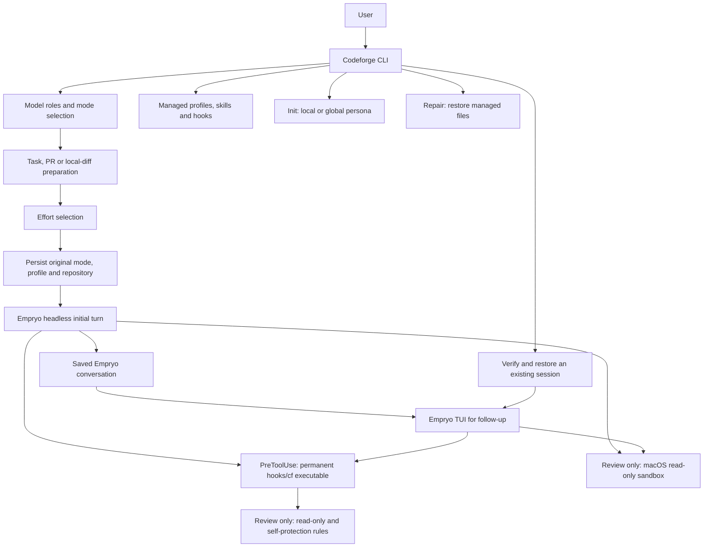
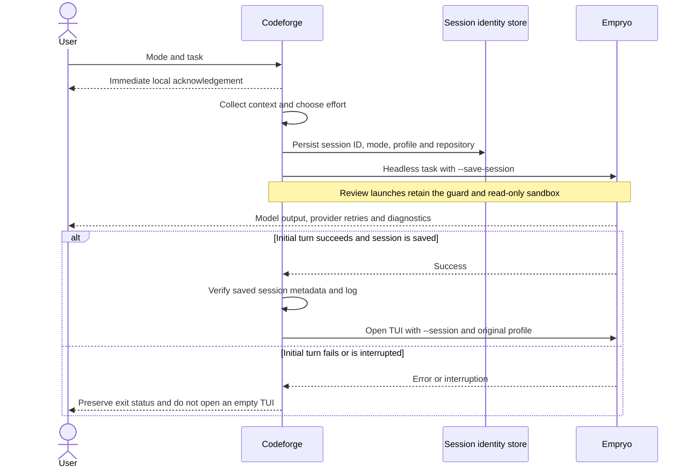
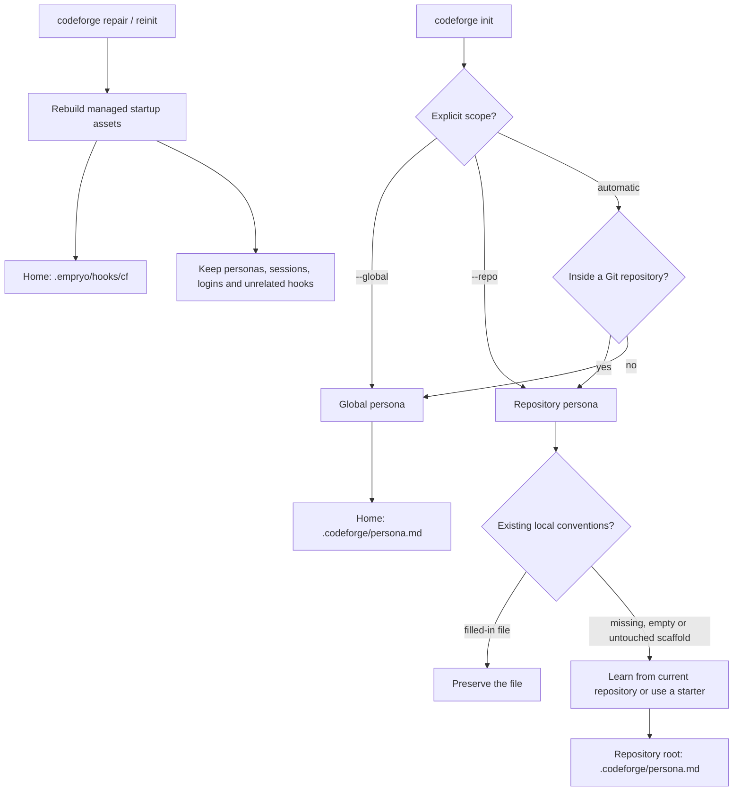
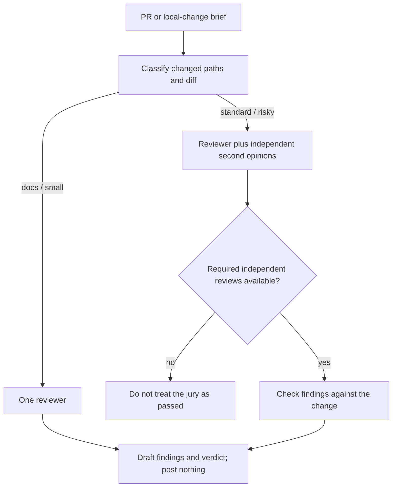

# Codeforge: architecture and design references

For installation and everyday commands, use the [README](README.md).
This guide explains the implementation, trust boundaries, and research behind the design.
It describes the code in this repository; provider capabilities and Empryo behaviour can change independently.

## 1. System overview

Codeforge is a Go CLI around Empryo, not a second model/tool execution engine.
It prepares tasks, installs its managed assets, chooses models and effort, records session identity,
and applies its review-mode protections. Empryo owns model requests, tools, context management,
provider fallback, the transcript, and the terminal chat screen.

The local acknowledgement is deliberately independent of the model. It confirms that Codeforge
received the job and is collecting context; it does not claim that a provider has answered.
A separate status identifies the transition to waiting for the model.

### Launch and resume

This two-phase launch accommodates the observed Empryo 3.12.3-beta TUI startup behaviour:
positional prompts are submitted by the headless path rather than by opening an idle TUI.
An explicit `--headless` launch remains headless. A resume skips task preparation and does not
resubmit the original task. Ctrl+C reaches the child through the foreground process group;
SIGTERM sent to the supervising CLI is forwarded to its child.

Implementation: [run.go](src/run.go), [shutdown.go](src/shutdown.go),
[sessions.go](src/sessions.go), [acknowledge.go](src/acknowledge.go).

### Terminal forms

Every menu and prompt (mode picker, init, model and provider wizards, trust questions) is a declarative
[forms.Form](src/forms/forms.go) that codeforge hands to `codeforge-forms`, a second program shipped next to it,
over a pipe; the answers come back the same way while the terminal itself stays with the helper. The terminal UI
library (huh/Bubble Tea) is linked only into that helper: at start-up it asks the terminal for its colours and waits
five seconds where nothing answers, a cost codeforge, its hooks and every `gh`/`git` interception would otherwise
pay on each run. `codeforge doctor` reports the helper; `CODEFORGE_FORMS` points at it when it lives elsewhere.

Implementation: [forms](src/forms/forms.go), [cmd/codeforge-forms](cmd/codeforge-forms/main.go).

## 2. Initialisation, personas, and repair

- Automatic init inside Git writes at the repository root, even when invoked from a subdirectory.
  It does not replace the global persona. Explicit repository input paths retain the historical
  global-learning form; `--global` makes that intention clear.
- `init --persona` opens a selector with the available starter names and short descriptions.
  An explicit name, such as `--persona oss`, skips the selector. Non-interactive callers must
  supply a name; otherwise the command lists the choices and stops without writing a persona.
- Existing, filled-in repository personas are not overwritten. Empty files and an unchanged
  repository scaffold can be populated. Failed generation does not replace a persona with an empty result.
- Local rules take precedence over generic/global style where they differ, but never override safety rules.
  A repository persona is trusted by content hash, not merely by its path. User-initiated init trusts
  the newly created file; changed or unfamiliar files need approval before being injected as system context.
- Persona history is input data, not instructions. The distillation prompt asks for evidence-based rules
  and excludes secrets and identifying examples. Inspect a learned persona before committing it.
- `repair` (`reinit` is an alias) reinstalls managed assets without model calls or sign-in.
  It runs automatically once per released version, before any command, when `~/.codeforge/repaired-version`
  differs from the running version. Development builds and agent shells inside a session (`CODEFORGE_LAUNCH=1`) never trigger it.
  It is not a factory reset and does not repair malformed user configuration, expired credentials,
  provider quotas, or network outages. Restart affected sessions after repair so cached hooks are reloaded.

Implementation: [initcmd.go](src/initcmd.go), [persona.go](src/persona.go),
[repopersona.go](src/repopersona.go), [trust.go](src/trust.go).

## 3. Enforcement boundaries

The permanent `~/.empryo/hooks/cf` helper is a private executable copy of the running Codeforge
binary. It is refreshed atomically; its lifetime is independent of temporary build paths and Homebrew
Cellar cleanup. Hook registration uses this helper.
The installer replaces recognised legacy Codeforge entries, including `/tmp/cf`, while retaining
unrelated hooks and other hooks sharing the same rule. Unknown renamed binaries are not assumed to be
Codeforge: the user can explicitly identify one with `repair --legacy-hook /absolute/old/path`.
That migrates only exact executable/Codeforge-subcommand matches in the global hook registry;
a missing match produces a warning to inspect project or other agent settings. It does not disable
fail-closed behaviour or indiscriminately delete missing security hooks.

The `PreToolUse` guard is registered globally and is **fail-closed**. In review sessions
(`CODEFORGE_GUARD=review`) it enforces read-only plus the self-protection rules (no settings changes, no
`codeforge trust`, no editing the guard). Every other session is not gated, except that the agent may not write
learning evidence (`codeforge observe`, `codeforge learn`, directly or through an interpreter or script), because
that would record its own words as the user's corrections. In review sessions, if the guard cannot run, the tool call is not allowed through; elsewhere an unreadable call passes. Outside review, interpreter code, wrapped commands and readable scripts that mention `codeforge` (and scripts too large to read) are refused, as are commands the guard cannot parse (process substitution, git aliases that run programs), since they could build `codeforge observe` in ways no pattern reads. This is a heuristic: a name carried across a `sh -c` boundary in an environment variable, or piped into a bare shell, is not caught. Outside review the guard no longer blocks `codeforge trust`, settings changes or terminal drivers such as `script` and `tmux`, so an agent there could approve its own trust; that is the accepted cost of gating review mode only. There is no managed `gh` shim:
`repair` deletes one that earlier versions installed, only if it carries Codeforge's marker (the `gh-shim`
subcommand remains for a stale copy). The `SessionEnd` resume-hint hook is fail-open because shutdown must not
wait on a hint. In review, agent tools may not alter the guard, its helper, its configuration, or run
user-only setup/repair commands. Repair does not disable these protections.

Review mode adds two distinct layers:

1. The tool guard blocks write operations, pushes, merges, review verdicts and writable commands. `codeforge` itself is
   matched by subcommand, not by name: `-h`/`--help` on any command, `version`, `doctor`, `models` and `provider` in their
   printing forms are allowed; every other subcommand, and any unknown one, is refused. Help is safe because `main` and
   `Run` answer a standalone `-h`/`--help` (before any `--`) with usage text before reading config or touching state, using
   the same rule as `guard.HelpRequested` (a test keeps them identical). `gh-shim` is the one exception: it forwards its
   arguments to gh, so it never answers help. A call the guard allows because it only prints (`models`, `provider show`)
   also skips the automatic repair and never offers to trust a project config, so it writes nothing. The guard judges the
   command before the shell expands it, so a call whose arguments could expand (`$`, backtick, glob, brace, a leading
   `~`, or a substitution anywhere in the line) is never treated as help or read-only; this also refuses harmless quoted
   text such as `codeforge chat 'why?' -h` in review mode, because arguments are compared after the tokenizer has removed
   quotes. Run `codeforge --help` plain instead. The one exception is
   `gh pr comment <PR> --body '…'` with its text on the command line: the hook answers `ask`, Empryo shows the user the
   exact call in the TUI, and it runs only if they approve. A body from a file, editor or stdin, an edit or delete of an
   earlier comment, and any other command in the same call stay refused.
2. On macOS, `sandbox-exec` refuses filesystem writes within the repository, except its `.empryo`
   runtime state. Both the initial headless turn and resumed TUI keep this sandbox.

This is **not** a network-isolation sandbox. Provider calls and other permitted network reads remain
possible. Review currently refuses to start without the supported macOS sandbox rather than silently
running with weaker filesystem protection. Outside review, Git is not an approval-gated workflow.

Implementation: [hookbinary.go](src/hookbinary.go), [hooks.go](src/hooks.go),
[hookcmd.go](src/hookcmd.go), [guard/](src/guard/), [enforce.go](src/enforce.go),
[sandbox.go](src/sandbox.go).

### Learning from use

Codeforge registers async, fail-open `PostToolUse` and `PostToolUseFailure` hooks for `Bash` that run
`codeforge observe`. In sessions codeforge launched (not review sessions, not jurors) the hook records whether
plain verification commands (`go test`, `golangci-lint run`, `npm test`, `make test` and similar; see
`verifyPrefixes`) passed or failed, as `origin=hook` outcomes in the sessions database. Commands with shell
operators, substitutions or redirects are never recorded.

A command that passed at least twice and whose latest run passed is a **habit**. Up to five habits are added to
the system prompt, after the repository persona, as suggestions that never override the request, and a line on
stderr says so. `codeforge learn habits` lists them with the IDs to pass to `codeforge learn revert`. Only
commands the harness reports as succeeded or failed count; the agent's own claims do not. Without an exit code in
the payload, a success event is stored as `incomplete` and does not count until the payload shape is confirmed
from `~/.codeforge/observe-shape.log`, which logs event and key names only.

### Corrections and rules

The same observer is registered for `UserPromptSubmit`. A submitted prompt that starts with a correction cue
(`correctionCues`, 8 to 300 printable characters, no credential shape) in a session codeforge launched is stored as a
correction with origin `hook`; the shape log records only the event and a reason, never the text. Corrections are
embedded locally (`embed`: 256-dimension feature hashing of word stems and trigrams, no provider call) and stored in
the sqlite-vec table `correction_vec` (`modernc.org/sqlite/vec`, CGo-free; created from Go after migrating so a
missing extension can never roll back the schema). `codeforge learn proposals` links corrections whose cosine
similarity is at least 0.75 and offers groups seen at least twice across at least two sessions; without the extension
it falls back to word overlap. At launch (`adoptRules`, not in review sessions) a group becomes a rule by itself only when the user typed the same
sentence (case, punctuation and spacing aside) in two different recorded sessions, because no text comparison can
prove that "enable X" and "disable X" mean the same; differently worded groups stay proposals for `learn accept`. At
most 3 rules per launch and 10 per directory, each announced on stderr with its undo command. Corrections count only in the directory
they were made in, so a root correction never creates a frontend rule. `learn forget RN` also declines the wording
for good; `learn accept PN` and `learn dismiss PN` decide early, by stable group ID (the smallest correction ID in
the group), never by list position. Rule text is checked again when it is loaded into a prompt. Opposite corrections
("use X" and "do not use X", or "not X" versus "not Y") never group, and an accepted rule never suppresses its opposite. The embedding
groups by shared wording, not by meaning ("avoid mocks" and "use real databases" will not group). sqlite-vec is MIT
licensed; see THIRD_PARTY_NOTICES.md.

Prompts count as the user's words only when the engine was started by a person: codeforge sets `CODEFORGE_HUMAN=1`
for a launch with a terminal on both ends that is not nested in another codeforge session, and clears any inherited
value, so a launch the agent makes from inside a session never earns it. This is process-environment provenance, not
authentication: an agent that starts Empryo directly, outside codeforge, would not carry the marker either (Empryo
reads the hook environment from codeforge), a headless launch has no terminal, so its prompts never count.

Residual risk: habits come from commands the agent chose to run, so they are influenceable by the agent and
not fully trusted. The agent cannot call `codeforge observe` (the guard refuses it), and a payload must name a
session codeforge launched in the same repository, but it can still run its own verification commands. A habit may only
contain words, paths, flags and simple values (`plainCommand`: no comments, quotes, operators or substitutions),
starts with a known verification command, takes only flags with small values, paths that exist in the repository and at most one bare word, needs two passes, and is shown to you at launch and in
`learn habits`. It is still text from the agent's own history in a later prompt; `learn revert` removes it.
`learn revert` with several IDs applies them in order and stops at the first error, leaving earlier IDs reverted.
Outcomes are ordered by when the async hook wrote them, which can differ slightly from when the commands ended.

## 4. Effort routing and model roles

The effort classifier borrows the idea of allocating inference compute by task difficulty [1–5]
and uses rubric-based judging [6] with a diverse judge panel [7]. It is not an implementation of the
papers' trained routers, nor evidence that their reported cost or accuracy gains transfer to Codeforge.

For applicable prompted launches without an explicit effort, judges independently score ambiguity,
blast radius, risk, novelty, and verification difficulty from 0 to 2. Risk uses the maximum score;
the other dimensions use the rounded mean. A deterministic rule chooses the effort:

- **High:** risk is 2, ambiguity is 2, total is at least 7, or verification is 2 with total at least 5.
- **Low:** total is at most 2, provided no high-effort rule applies.
- **Medium:** otherwise; also the fallback when all judges fail.

Ticket and prompted chat launches can use this classifier. Work starts at medium without startup
judge calls; an idle chat starts at low. Interactive review defaults to high. An explicit supported
`--effort` wins, but Codeforge rejects levels above high.

The model-role settings are `model`, `expert`, `judges`, `review.model`, `review.second_opinion`, and `init`.
The new-install coding default is Opus 5.5; the `codeforge-expert` delegate uses Fable 5.2 only for a bounded difficult task, and `init` defaults to Sonnet 5.5 unless a coder is set.
Saved model choices are not overwritten. Gemini 4 Argon is excluded from Codeforge recommendations and selection lists;
existing manually configured native Empryo routing/fallback settings are not silently rewritten.
Recommendations try to separate model families. Configuration validation rejects identical model IDs
for author/reviewer and reviewer/second opinion; that is not proof of independence when two IDs reach
the same underlying model through different providers.

Provider routing and fallback are separate from Codeforge's role selection. Empryo handles failures,
backoff, and backup-model attempts. Changing provider does not bypass shared connectivity failures,
and an acknowledgement is not proof that the provider request succeeded.

Implementation: [launch.go](src/launch.go), [effort/effort.go](src/effort/effort.go),
[models.go](src/models.go), [config](src/config/config.go).
The project design paper and historical evaluation are in [adaptive-effort.md](docs/adaptive-effort.md).
Its small evaluation set is not a release-by-release benchmark or a guarantee of calibration.

### YAML configuration and launch-only overrides

`codeforge models configure` lists the authenticated provider catalog and opens role selectors.
The wizard asks for project or global scope; `--project` and `--global` select it explicitly.
It saves only after confirmation and validation, using a private, atomically replaced YAML file.
Cancellation leaves existing settings unchanged. Existing, temporarily unavailable model IDs are labelled as saved rather than falsely listed as available.

- Global settings: `~/.codeforge/config.yaml`. Legacy `~/.codeforge/config.json` is read only when YAML is absent.
  The files are alternatives, not merged layers. Saving keeps the old JSON file unchanged and writes the complete selected YAML configuration.
- Project overrides: `.codeforge/config.yaml` at the Git repository root, including when launched from a subdirectory.
  They are content-hash trust gated before parsing/application, just like repository personas. An unapproved or changed checkout cannot
  nominate its own reviewers or routing; non-interactive launches skip it with a notice. Inspect manual/shared changes and run
  `codeforge trust --models` to approve them. The wizard records the exact bytes it writes, not a second read vulnerable to substitution.
  Repair and trust operate before project configuration is loaded, so a broken checkout file cannot prevent recovery.
  The trust dialog shows the complete parsed effective model settings, not a raw prefix that comments could pad to hide reviewers.
  Declining an existing file's trust does not authorize overwriting it: the project wizard separately asks before replacing an unapproved file.
  This approval covers Codeforge's model file only, not arbitrary Empryo project configuration or programs it may start.
- Precedence for Codeforge roles: explicit `--model` for the active role, then `CODEFORGE_*` environment values,
  then project YAML, global YAML/legacy JSON, and built-in defaults. `CODEFORGE_INIT` controls persona generation;
  `CODEFORGE_EXPERT` controls the on-demand expert. When `init` is omitted, persona generation follows the configured coding model rather than silently selecting another provider.
- `models set` and setup's `fill` retain their global Codeforge YAML write scope. `models recommend` is read-only.
  `models apply [--project|--global]` applies saved fallback choices and the coding model (as `defaultModel`, which the Empryo TUI selects on start) to native Empryo. With `--recommended`, it first previews
  recommended role changes, saves them only after confirmation at the chosen scope (project changes are content-approved), keeps helper routing and other settings, then applies fallback. It requires a terminal,
  offers an inferred scope (project inside Git or with a local model file, global otherwise), previews exact native changes and asks for confirmation.
  Explicit scope flags skip the scope selector, not confirmation. Global application reads only saved global choices; project application uses approved project overrides.
  One-off environment model overrides are excluded from persistent application.
  `models` displays effective project-aware roles. YAML rejects unknown keys, duplicate mappings, invalid types, and multiple documents.

The schema also accepts `providers: {primary: devpass, fallbacks: [copilot, openrouter]}` and model names such as `Sonnet 5.5`.
The older single `fallback:` key is still read and placed first; `codeforge provider set PRIMARY [BACKUP...]` writes the list form.
Each named role resolves to one catalog ID per provider, and the ordered backups become that model's native `modelFallback` list.
`provider set` resolves every saved role on every listed provider before saving, so a chain is never saved half-working.
`providers.rules: [{match: 'claude-*', primary: anthropic, fallbacks: [openrouter]}]` gives a model family its own chain; `provider set ... --for GLOB P1,P2` writes it.
The first rule whose glob matches the normalised model reference (`Sonnet-*` is `claude-sonnet-*`) replaces the default chain for that model, and its stand-ins are limited to the model's own family.
Patterns allow only `*` and `?`. Unset parts of a saved policy are kept by `provider set`; the picker, recommendations and project previews route each model by its own chain.
A backup that is another family's declared primary keeps its declared chain in `verifyFallbacks`.
Fully qualified IDs bypass rules, and a project's `providers` block replaces the global one, rules included.
`devpass` resolves to the native `llmgateway` provider ID; this is an account alias, not a billing override.
The wizard offers a provider-defaults style and an advanced explicit-ID style. Names resolve against authenticated-provider catalog IDs,
normalising spaces, version punctuation, and Claude family aliases. Unknown or ambiguous names fail before a model-backed task.
Explicit `provider/model` IDs retain their previous semantics, including unavailable saved IDs and native fallback.
Switching styles is an explicit migration of model references at the selected scope; cancelling does not save it.
Provider policies replace the corresponding global policy as a block; a project `providers: {}` clears inherited provider defaults.

A backup uses the same named model when it serves it; otherwise `equivalentModel` (src/model_levels.go) picks a stand-in: the nearest version of the same model line (older first), else the newest same-level model from the same vendor, then any vendor. Levels come from name words (opus/sol/kimi/pro, sonnet, haiku/luna/flash/nano/mini). A provider with nothing of the same line or level is refused. Stand-ins are marked `(closest)` in plans. Only an explicit, confirmed `models apply` installs fallback maps;
configuration, plan inspection and normal launches remain non-writing. No unproven preset overlay is used.
Before model work it reads global, project, and effective `modelFallback` settings through the documented ACP config extension,
without a prompt or config write, then deletes only its own query session. Declared and effective chains must both match, including
no undeclared extra backup hop. Missing or incompatible chains fail closed and direct the user to `models apply` or Empryo `/router`.
The apply command uses `_empryo/config/set` for the single `modelFallback` key after re-reading native layers and checking that they still match the approved preview.
It preserves unrelated rows and other settings, explicitly previews clearing undeclared extra backup hops, and verifies persisted results in a fresh read-only process.
Native project `modelFallback` replaces the whole global map; creating a project override therefore retains currently effective unrelated rows. These copied rows become project pins.
Native global writes clear the current session workspace's project override, so global application runs in a neutral temporary workspace, never the active repository.
Cancellation does not write settings. A stale preview aborts rather than overwriting intervening fallback edits; unsupported native APIs fail without a JSON-file fallback.
`codeforge models plan` prints resolved IDs and performs the same read-only verification; it does not make a model request.
Quota retry timing and actual failover remain native Empryo behaviour. No backup preference means native fallback is inherited without this check.
Roles, explicit helper routing, environment model references and CLI model arguments are resolved before generation; flag values are not reinterpreted as options.

See the complete [example configuration](config.example.yaml). The `routing` map accepts the supported Empryo profile jobs:
`research`, `editing`, `explore`, `web-search`, `cleanup`, `verify`, `review`, `goal-review`, `summaries`, and `marionette`.
Project routing entries replace the corresponding global Codeforge routing entries; an empty string resets a job to native Empryo routing.
The wizard distinguishes inheriting global routing (no entry) from explicitly resetting to native Empryo (an empty string).
Project saves record changed model roles rather than copying all global values, so future global changes still propagate.
Existing explicit project pins and routing reset entries are preserved when other roles are edited.

Codeforge passes primary-role models through native `--model` flags and installs workspace-local Codeforge agent profiles with native `routing` metadata.
Project profiles prevent two projects from overwriting one another's model/routing choices in global profiles.
The normal Empryo config file, credentials, default profile, and unrelated profiles are not rewritten.

Profile routing does **not** control every background request. Tab naming, Genome summaries, advisor, council, and other non-profile jobs
remain under Empryo's task router. Unsupported routing keys are rejected, not silently advertised as overrides.
Provider authentication, quotas, fallback chains, retries, and native background routing remain Empryo responsibilities.
See [Empryo profile routing](https://empryo.com/docs/tools/profiles#routing-jobs).

Implementation: [config/yaml.go](src/config/yaml.go), [models_configure.go](src/models_configure.go),
[profile_routing.go](src/profile_routing.go), and [config.example.yaml](config.example.yaml).

## 5. Reviews and independent checks

Review briefs collect intent, commits, checks, prior reviews, tickets, and the diff before asking
for findings. Author-controlled PR text is marked as data. The review playbook draws on engineering
review practices [8], labelled feedback [9], security taxonomies [10–11], delivery/operability research
[12], and work on resolving review comments [13]. These are design references, not certifications.

Triage sizes a review in two steps. File kinds that are infrastructure or schema (`.sql`, `.tf`, `.proto`,
migrations, deploy and workflow folders, Dockerfiles) and docs-only changes are decided from paths alone. Every
other change is scored by the cheap judges (`judges` in the config) on risk and complexity, from what the change
does, not from which words it contains; the file-kind result is a floor the judges cannot lower. Ordinary
behaviour changes get one reviewer; a second opinion needs a reason: one judge alarmed (risk 2) or logic the judges
find hard to verify (complexity 2), and the full jury needs the judges to agree on risk 2. If no judge
answers, the review uses the standard tier. `docs` and `small` skip the jury; `standard` asks one second opinion;
`risky` asks all of them. `docs` and `small` get 4 and 5 tool steps, so cost stays bounded on the changes that need
the least checking. Only `docs` uses `review.light_model`, because the reviewer rather than the classifier is most of
a review's cost. Small code changes keep the normal reviewer: the light model let through a documented-contract
violation there.

The TUI theme is shown by writing `theme.name` into the global Empryo config while the TUI is open
([themescope.go](src/themescope.go)). Empryo reads its theme from `~/.empryo/config.json` only: a project's config and the
environment are ignored for it (measured by drawing the TUI in a pty with each), and there is no flag. A ledger in
`~/.codeforge/theme-ledger/` records the config's resolved path, the original bytes and permissions, the user's own
`theme.name`, the hash of what was written and the open Codeforge TUIs, under a lock. The user's theme goes back when the
engine has exited, never because a signal arrived: Empryo can rewrite the config for as long as it runs. `runEngineWith`
catches SIGTERM, SIGHUP and SIGQUIT, forwards them to the engine as SIGTERM, gives it `stopGrace` (3 s) to exit and then
kills it, and calls the undo before anything is printed (a closed terminal cannot be written to). SIGINT is left to the
engine, since Ctrl+C in the TUI cancels a turn. `runThemed` registers the signals before the config is touched, and the
undo is guarded by `sync.OnceFunc`, so the deferred call and the signal path never double-revert. If the file is exactly
what Codeforge wrote it returns to the original bytes; if Empryo has saved it since, only `theme.name` goes back, and only
while it is still the Steel theme, so a theme chosen with `/theme` stays. A restore that fails keeps the ledger. SIGKILL
cannot be caught: the next launch restores first, even one started with `CODEFORGE_THEME=off`. A config that is a link is
changed where it lives and stays a link; other settings keep their exact text. Nothing is written when the config has
comments, does not exist, already uses a Steel theme, the theme file is not installed, or `EMPRYO_HOME` points Empryo at a
different home than the one the themes are installed in. SIGHUP is only caught when the process did not start with it
ignored, so `nohup` keeps working. A Codeforge TUI started with the theme switched off still holds an applied theme until
it exits, since its engine reads the same config. An engine that ignores SIGTERM is killed after the grace, but only the
engine itself: tool processes it started can outlive it. Limits: nothing repairs a Steel theme that a separate plain
`empryo` session, or such a leftover process, saves back after the last Codeforge TUI has closed (the next launch cannot
tell it from a Steel theme you chose); recover with `/theme`. Ledgers from v0.11.4's per-project design are not read. Tradeoffs: any Empryo session
started while a Codeforge TUI is open shows Steel too, and a setting Empryo saves in the instant between Codeforge reading
and replacing the file can be lost.

`review.sensitive_paths` lets a repository's owners name paths that always get the `risky` tier, whatever the judges
say: `auth/` (a directory of that name at any depth), `src/guard/*.go` (a path) or `*.sql` (a file name). A project
file adds to the global list and never removes from it, so it can only add scrutiny. A change of 100 KB or more of
diff prints a one-line suggestion to split it; the review still runs. Both follow the account of Anthropic's code review
in [14], which sets review effort by what a change touches and keeps changes small. The same account is why
`TestEvalHistory` measures recall on changes that a later fix commit repaired, rather than only on injected bugs: it
judges a review regime by what it lets through.

After the reviewers answer, the gate runs the repository's own tests, whatever the reviewers voted: when a changed Go
package fails `go test`, the gate blocks on that failure and caches no verdict. This is deterministic, costs no model
call, and exists because a reviewer that found a defect could file it as a non-blocking finding while still returning
pass.

The interactive review's jury requirement is expressed in the brief and skill. The separate voluntary
`codeforge gate` also has programmatic quorum, verdict parsing, cache, and finding-grounding checks.
Do not confuse a rendered draft with a machine-validated gate pass. A quota failure or repository rule
forbidding a configured juror does not count as an independent review and must not silently become approval.

Implementation: [reviewcmd.go](src/reviewcmd.go), [review/triage.go](src/review/triage.go),
[review/jury.go](src/review/jury.go), [gate.go](src/gate.go),
[review skill](assets/skills/codeforge-review/SKILL.md).

### Reviewer-to-work handoffs inside one TUI

Work/chat can run the existing sandboxed `codeforge gate` or `codeforge review <PR> --headless` command without opening a second terminal.
The named `codeforge-reviewer` helper has a read-only native tool allowlist: read, grep, find, navigate, and final response.
It can ground findings and return `FIX_REQUEST` or `COMMENT_DRAFT` proposals, but cannot execute commands, edit, dispatch writers, or publish.

The writable parent can delegate user-authorized fixes to `codeforge-work`. A child report is not permission to change files or somebody else's branch.
For public feedback, the parent must show the exact PR target and final comment text and obtain explicit human approval before posting that draft.
Posting a comment is not approval of the PR, nor permission to push or merge. This approval workflow is expressed in the managed parent instructions;
it is not a new server-side GitHub authorization mechanism.

The native helper allowlist and the standalone review's OS sandbox are distinct protections.
A standalone read-only review cannot gain writes through a profile switch or by starting a writer inside its sandbox.
Fixes and approved publication must be handled by an already writable parent, or a separately launched writable conversation.

Implementation: [reviewer definition](assets/agents/codeforge-reviewer.md),
[work profile](assets/agents/codeforge-work.md), [chat profile](assets/agents/codeforge-chat.md).

## 6. State and recovery

| Location | Purpose |
| --- | --- |
| Repository `.codeforge/persona.md` | Project-specific conventions |
| `~/.codeforge/persona.md` | Global conventions |
| Repository `.codeforge/config.yaml` | Project model roles and profile routing overrides |
| `~/.codeforge/config.yaml` | Global Codeforge roles, routing and default mode |
| `~/.codeforge/config.json` | Legacy global configuration, read only when YAML is absent |
| `~/.codeforge/trusted-personas.json` | Persona and model-config content approvals; legacy filename retained |
| `~/.codeforge/sessions/sessions.db` | Original session mode/profile/repository and inert learning evidence |
| Repository `.empryo/sessions/ID` | Empryo metadata, transcript, and session state |
| `~/.empryo/hooks/cf` | Permanent managed hook executable |
| `~/.empryo/hooks.json` | Hook registration; other user hooks are retained |
| `~/.empryo/agents` and `~/.empryo/skills` | Generated Codeforge profiles and skills |

Session identity is recorded before the engine starts. Resume checks the saved workspace, metadata,
and transcript; missing or mismatched state fails instead of creating a fresh conversation.
The SQLite store uses embedded transactional migrations, WAL, full synchronous durability, bounded
lock/operation waits, and private filesystem permissions. Its learning observations do not change
prompts, approvals, or guard policy. Review verdict caching is separate from this store.

See [store/](src/store/), [sessions.go](src/sessions.go), [learncmd.go](src/learncmd.go),
and [review/cache.go](src/review/cache.go). Do not delete the database as a routine repair step.

Known concurrency limits: the JSON approval ledger is atomically replaced but concurrent approvals can still require reapproval after a last-writer update.
Owned profiles are workspace snapshots, not separate registries per terminal: simultaneous launches in the same workspace with different environment overrides
can replace each other's helper definitions. Different projects are isolated, and native Empryo configuration and Codeforge YAML settings are not rewritten by those launches.

## 7. Citations

These references are retained from the earlier technical README and the adaptive-effort design paper.
Research papers [1–7, 13] are distinguished from engineering guides, standards, a book/research programme and an essay [8–12, 14].
They explain influences on the design, not claims that Codeforge reproduces each paper's method or results.

1. Snell, Lee, Xu, Kumar. *Scaling LLM Test-Time Compute Optimally can be More Effective than Scaling Model Parameters.* arXiv:2408.03314, 2024. <https://arxiv.org/abs/2408.03314>
2. Ding et al. *Hybrid LLM: Cost-Efficient and Quality-Aware Query Routing.* ICLR 2024, arXiv:2404.14618. <https://arxiv.org/abs/2404.14618>
3. Ong et al. *RouteLLM: Learning to Route LLMs with Preference Data.* arXiv:2406.18665, 2024. <https://arxiv.org/abs/2406.18665>
4. Chen, Zaharia, Zou. *FrugalGPT: How to Use Large Language Models While Reducing Cost and Improving Performance.* arXiv:2305.05176, 2023. <https://arxiv.org/abs/2305.05176>
5. Han et al. *Token-Budget-Aware LLM Reasoning.* arXiv:2412.18547, 2024. <https://arxiv.org/abs/2412.18547>
6. Zheng et al. *Judging LLM-as-a-Judge with MT-Bench and Chatbot Arena.* NeurIPS 2023, arXiv:2306.05685. <https://arxiv.org/abs/2306.05685>
7. Verga et al. *Replacing Judges with Juries: Evaluating LLM Generations with a Panel of Diverse Models.* arXiv:2404.18796, 2024. <https://arxiv.org/abs/2404.18796>
8. Google. *Engineering Practices: How to do a code review* and *What to look for in a code review.* <https://google.github.io/eng-practices/review/>
9. *Conventional Comments.* <https://conventionalcomments.org>
10. OWASP Foundation. *OWASP Top 10.* <https://owasp.org/www-project-top-ten/>
11. MITRE. *Common Weakness Enumeration (CWE).* <https://cwe.mitre.org>
12. Forsgren, Humble, Kim. *Accelerate: The Science of Lean Software and DevOps.* IT Revolution, 2018; DORA research programme. <https://dora.dev>
13. Austin et al. *Resolving Code Review Comments with Machine Learning.* ICSE-SEIP 2024. <https://research.google/pubs/resolving-code-review-comments-with-machine-learning/>
14. Stanley. *Anthropic's Code Review as a Case Study in Evolving Work Governance.* Substack, 24 Oct 2026. <https://jasonstanley.substack.com/p/anthropics-code-review-as-a-case>
